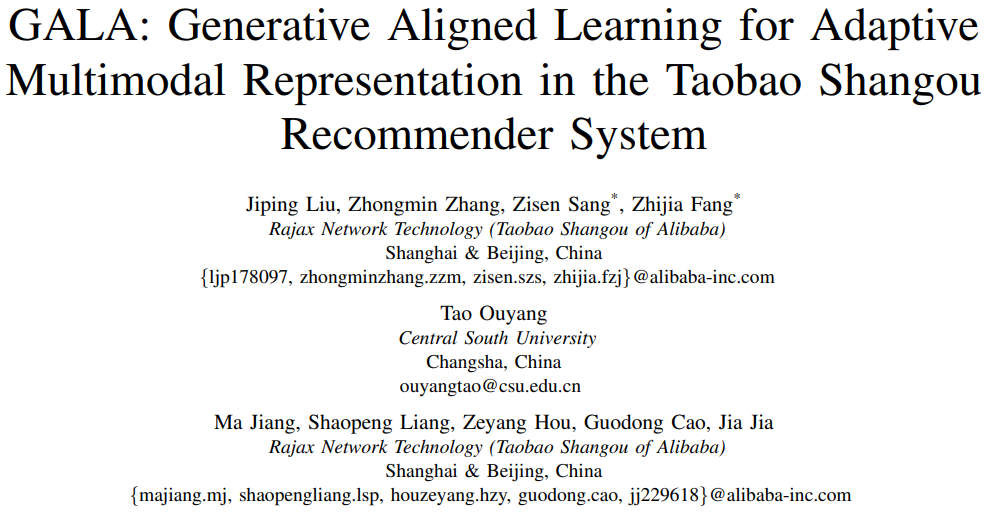
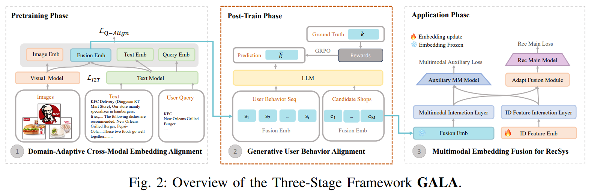
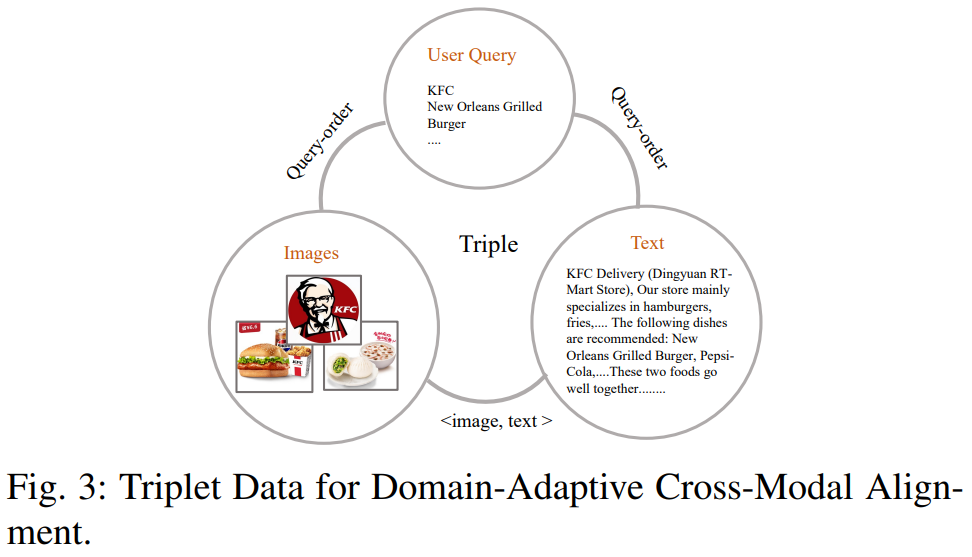
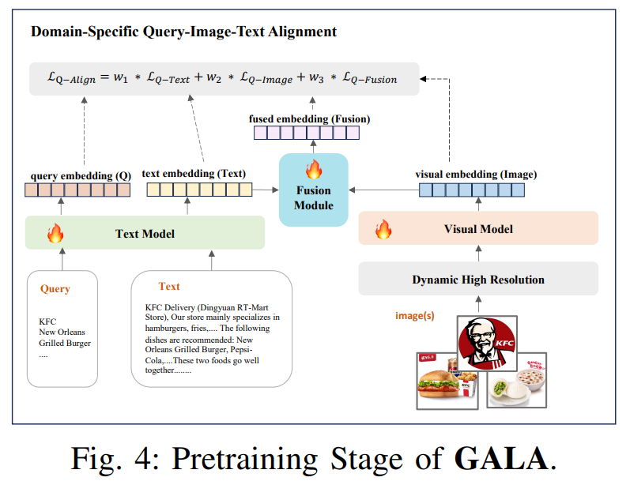
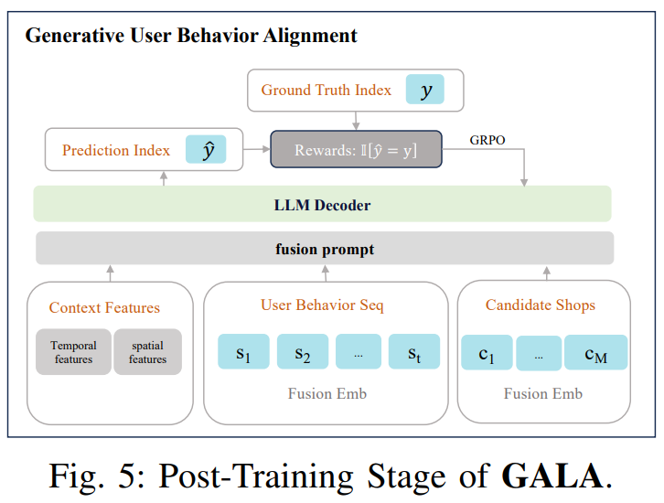
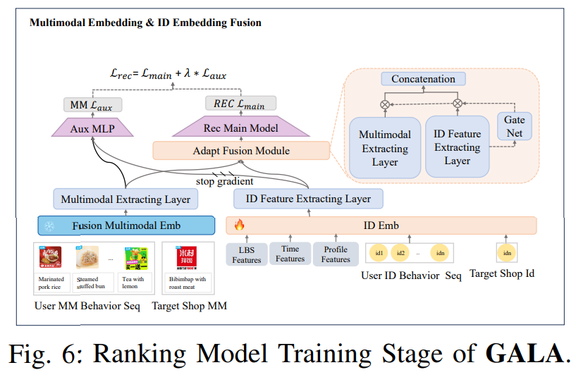
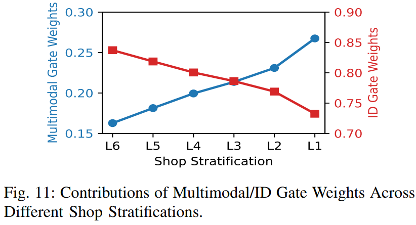
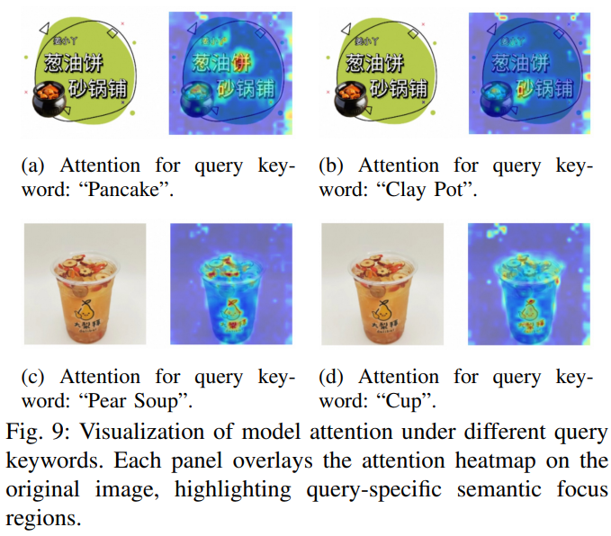

# 基本信息

* 论文标题：GALA: Generative Aligned Learning for Adaptive Multimodal Representation in the Taobao Shangou Recommender System
* 作者单位：阿里
* 论文链接：[https://arxiv.org/abs/2607.29213](https://arxiv.org/abs/2607.29213)
* 来源：ICDE 2026

# Motivation：论文要解决的问题是什么

目前在电商模型中使用多模态特征主要遵循两阶段范式：首先进行多模态预训练，这一阶段主要目的是对齐图文语义空间；然后将预训练的多模态表征加入到排序模型中，这一阶段主要目的是对齐基于用户行为的排序目标。

作者认为这两个阶段比较割裂，任务目标也不一致，导致效果欠佳。因此本文的方法就是在两阶段中间新增了一个阶段，变成了三阶段范式。新增的中间阶段是用第一阶段的emb在排序任务上进行GRPO微调，相当于将emb一定程度上对齐了排序目标，对原有的两阶段范式进行了桥接。此外，也对原有的两阶段进行了各自的优化。

主要应用场景是淘宝闪购外卖场景。

# 整体流程
三阶段的整体流程如图Fig2所示：
* Stage1：多模态预训练，对齐图片、文本等各种模态
* Stage2：多模态后训练，针对下游基于用户行为的排序任务微调多模态表征
* Stage3：多模态排序应用，设计了Gating机制自适应融合多模态表征和ID表征

# 多模态预训练
## 样本构造

外卖与电商有个很大的区别是，外卖搜索结果页是店铺排序，而电商是商品排序。

作者基于搜索下单日志，对每个店铺，拿到其最高频下单的10个query，以及这10个query下最高频购买的5个商品。由此拿到了三元组<query, shop, item>，其中shop有店铺文本描述信息text；item有商品图片image和文本text。

## 对齐任务

有了上述三元组样本之后，多模态预训练有两个对齐任务，第一个任务是商品本身的图片和标题的对齐，差不多是标准的CLIP或者对比学习了，没有难负例，直接用的in-batch负例。

$$
\begin{equation}
\mathcal{L}_{\mathrm{I2T}} = -\log \frac{\exp(t \cdot i_{+})/\tau}{\sum_{j=0}^{K} \exp(t \cdot i_{j})/\tau},
\end{equation}\tag{1}
$$

第二个任务是query到shop的对齐，包含三个子任务：query对齐店铺描述、query对齐高频商品图片、query对齐图文融合表征。如下图Fig4所示，图文融合作者采用的是Google T5的cross attention方式。最后把三个loss以不同系数加权起来。第二个任务的对比学习方式与第一个任务完全一样，也是InfoNCE loss和in-batch负例。

$$
\begin{equation}
\mathcal{L}_{\text{Q-Align}} = w_1 \mathcal{L}_{\text{Q-Text}} + w_2 \mathcal{L}_{\text{Q-Image}} + w_3 \mathcal{L}_{\text{Q-Fusion}}.
\end{equation}\tag{2}
$$

本文的多模态backbone是GME模型。

# 多模态后训练——生成式用户行为对齐
这就是本文重点强调的创新，传统两阶段方式在上一步预训练完成之后就可以产出多模态表征直接给到排序模型了。本文插入了一个中间阶段，即多模态后训练对齐排序任务。

这里的后训练也划分为几个步骤：
* 数据准备，根据搜索下单日志，构造如下数据： \((\mathbf{c}, \mathcal{S}_{1:t}, \mathcal{C}, y)\)，其中\(\mathbf{c}\)是context信息，如时间、位置等；\(\mathcal{S}_{1:t}\)是用户历史行为流；\(\mathcal{C}\)是M个候选店铺列表；\(y\)是{1,…,M}的下标，表示用户真正下单的店铺下标
* 对齐任务就是最大化如下目标：
$$
\begin{equation}
\max_{\theta} \log p_{\theta}(y \mid \mathbf{c}, \mathcal{S}_{1:t}, \mathcal{C}).
\end{equation}\tag{3}
$$
* 由于直接微调难度比较大，作者还做了一个SFT Warm up，就是用更大的模型（Qwen-72B）根据\((\mathbf{c}, \mathcal{S}_{1:t}, \mathcal{C}, y)\)标注了一个CoT，解释为什么用户最终会对\(y\)下单，由此得到带思维链的样本\(\langle (\mathbf{c}, \mathcal{S}_{1:t}, \mathcal{C}), r_{1:L}, y \rangle\)，其中的\(r_{1:L}\)就是推理过程。
* 因此作者先用Qwen-72B标注了1M的\(\langle (\mathbf{c}, \mathcal{S}_{1:t}, \mathcal{C}), r_{1:L}, y \rangle\)这个样本
* 然后用上述样本对小模型Qwen2.5-7B-Instruct进行SFT Warm up
* 最后才是真正的GRPO环节。

GRPO流程如图Fig5所示，Backbone是Qwen2.5-7B-Instruct，输入给模型的除了context是明文，用户店铺行为和候选店铺都是上一步产出的融合emb。

训练的时候，通过多次NTP采样，得到输出序列o，o包括推理CoT和最终预估的下单店铺下标（o的最后一个token）。因此作者设计了一个非常简单的奖励，如公式9所示，即预估下单店铺下标与真实下标一致得1分，不一致得0分。有了奖励之后，后续的GRPO就是常规操作了。

$$
\begin{equation}
r(s, o) = \mathbb{I}[\text{last}(o) = \langle\text{index}_y\rangle],
\end{equation}\tag{9}
$$

# 多模态排序应用

在多模态应用环节，常规操作是作为side info特征，或者人工构造一些统计特征比如SimTier等。作者认为这些方法没有突出多模态表征的作用，而且没有区分热门和冷门商品。故作者设计了如下图Fig6的多模态融合方法。

简单来说，分别有一个ID emb的用户表征模块，和一个多模态emb的用户表征模块，因此会产出ID的用户表征和多模态的用户表征。

对于主网络，设计了一个自适应的融合模块（Adapt Fusion Module），以ID用户表征作为Gate输入，自适应加权ID和多模态用户表征。这么设计的初衷是，对于热门用户和商品，ID表征已经学习比较好了，可以给ID用户表征更多权重。反之，对于中长尾用户和商品，由于数据稀疏，ID表征学习不足，因此给多模态表征更高的权重。

但是上述结构估计提升不够大，作者发现ID特征仍然会主导模型学习（gate collapse），导致多模态表征对主网络的影响有限。因此，作者又设计了一个辅助网络，通过MLP融合ID和多模态的用户表征，但是ID表征进行stop gradient，因此这一路的loss只影响多模态网络，通过这种方式加强多模态分支的学习和收敛。图中的\(\lambda=0.01\)，辅助loss的权重还是比较小的。

# 实验结果
核心结果肯定说自己好，这个就不展示了，有两个结果值得一提。

Fig11展示了店铺分层的结果，从L6到L1，表示店铺从热门到冷门，越冷门的店铺，Gate中的ID用户表征权重越低，多模态表征权重越高。虽然与设计相符，但是为什么会这样呢？

Fig9展示了相同的图片在不同query下的热度图，表示多模态emb能根据不同query关注到图片的不同区域。这个就更离谱了，整个方案并没有设计这种细粒度的对齐任务，为啥会学习到这种效果？？看着很有道理，但并不知道为什么。

# 评价
* 优点：
    * 在常规两阶段范式下新增了一个多模态后训练阶段，希望把多模态emb对齐到下游的排序任务中，出发点有道理，能解释得通
    * 多模态下游应用中，设计的自适应融合Gate，也有道理，热门用ID，冷门用多模态，但其实也可以反驳，即多模态也可以为热门ID提供增量信息，为什么不能全都要呢
    * 论文真能写，写了12页，但创新性有限，而且核心实验结果只有3个表格
* 不足：
    * 多模态预训练太常规了，没有新意
    * 多模态后训练的Reward设计太简单了，直接就是最后下单的店铺下标，既然这么简单为什么要用RL训练，直接有监督学习效果如何？有点为了RL而RL。
    * Fig9的case，文中并没有设计图文的细粒度对齐任务，负例也仅仅是in-batch的简单负例，为什么可以根据不同query关注到图片的不同细节呢？

