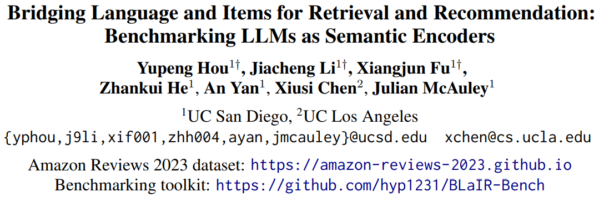
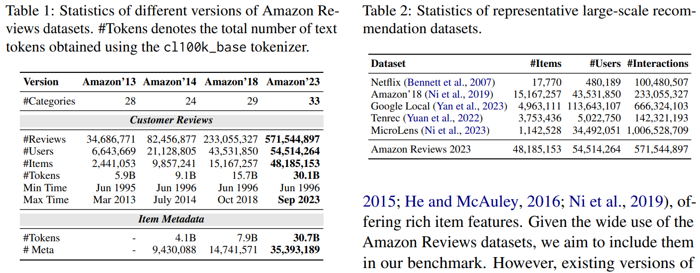
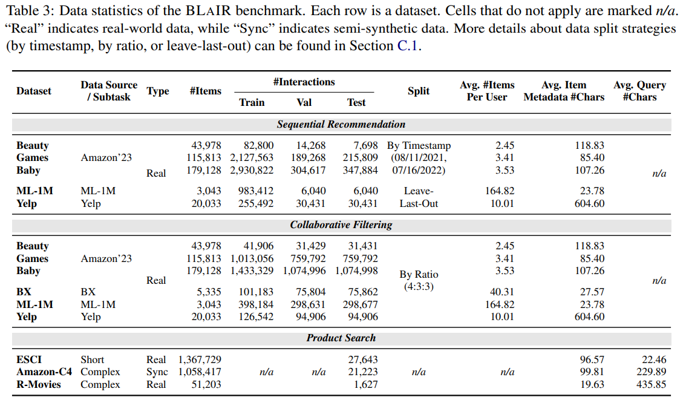
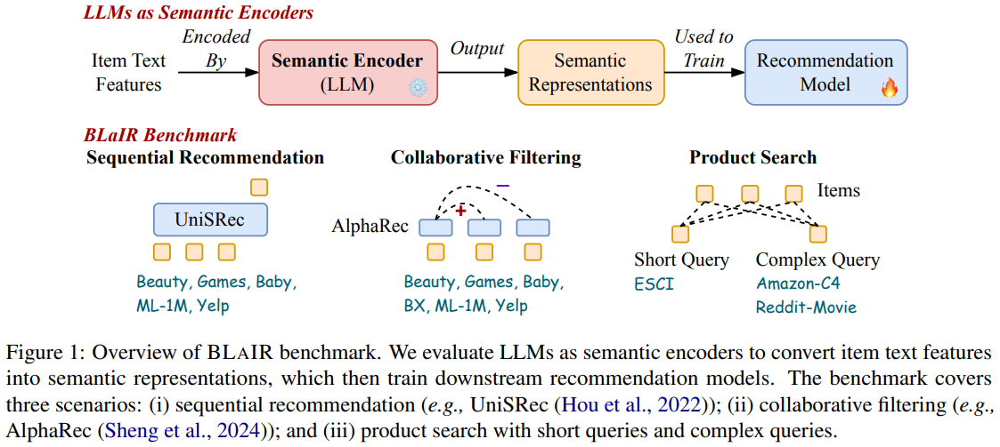
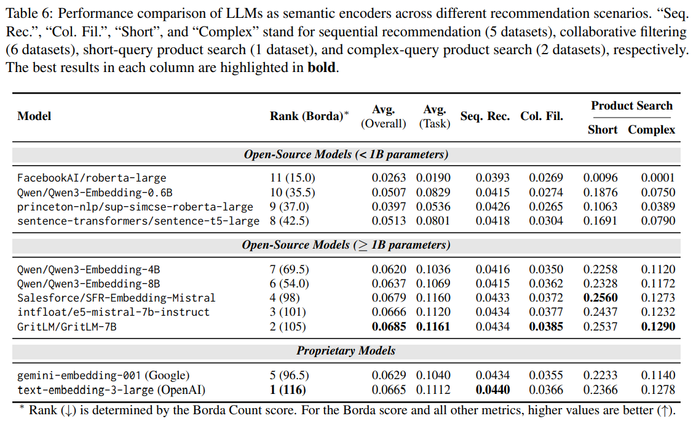
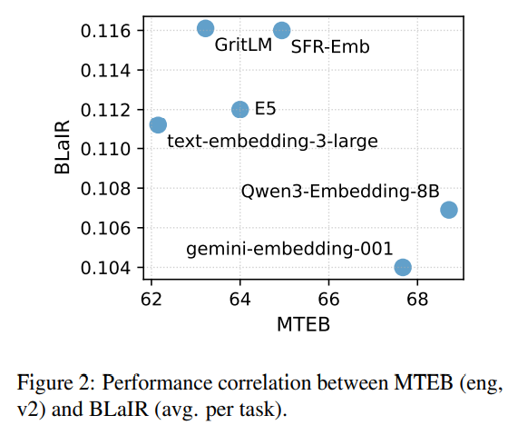
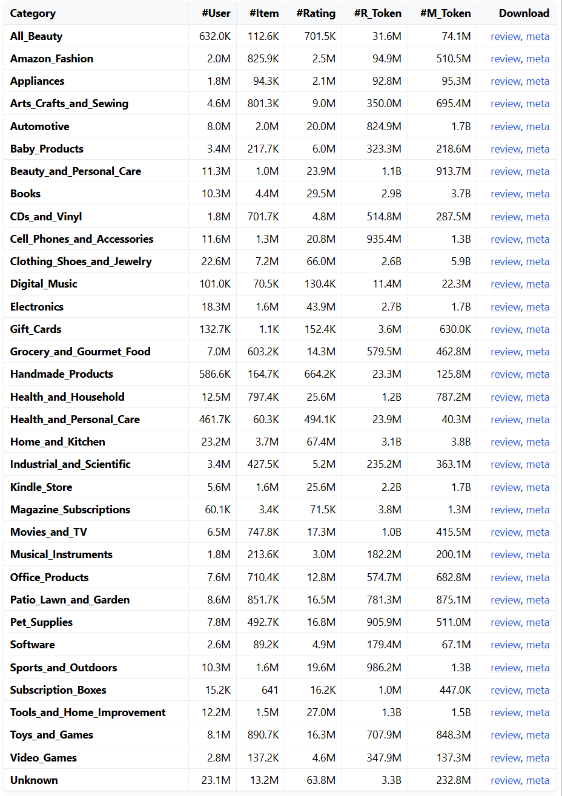

# 基本信息
* 论文标题：Bridging Language and Items for Retrieval and Recommendation: Benchmarking LLMs as Semantic Encoders
* 作者单位：加州大学
* 论文链接：[https://arxiv.org/abs/2403.03952](https://arxiv.org/abs/2403.03952)
* 来源：ACL 2026

# Motivation：论文要解决的问题是什么

文本模态emb的效果评测通常使用MTEB评测集（[https://arxiv.org/abs/2502.13595](https://arxiv.org/abs/2502.13595)），但是这个评测集的任务是通用场景的emb召回排序任务，无法反应emb在搜推场景下的效果。

通用场景和搜推场景在emb使用方面存在如下差异：
* Emb在搜推场景只作为一个基础特征，上层有比较复杂的搜推模型。但MTEB评测任务都是直接用emb进行相似度检索。两者使用方式有较大差别
* 搜推场景的文本通常比较短，且存在关键词堆砌，噪声较多。而MTEB中的文本通常是格式规范的句子或者段落。两者文本数据分布差别较大

因此，emb在MTEB和搜推场景下的效果可能不完全一样。本文的核心就是提供一个针对电商搜推场景的评测集及评测任务，作搜推场景的benchmark。

# Amazon Reviews 2023 dataset
本文最大的贡献是提供了一个大规模的搜推数据集：Amazon Reviews 2023 dataset。这个数据集爬取了1996~2023年之间的33个类目的所有用户评论数据，主要包括两部分，一部分是(user, item, review)评论数据，另一部分是(item, info)商品信息。而且难能可贵的是，用户评论、商品标题、图片都是明文数据，可以进行多模态分析。如下Table1和Table2所示，该数据集无论是数据规模还是时间跨度，相比其他数据集都有明显优势。

数据下载地址见：[https://amazon-reviews-2023.github.io/](https://amazon-reviews-2023.github.io/)，该页面中分不同类目对数据集进行了拆分，拆分之后，在每个类目，用户的历史行为就比较短了，如下Table3的Avg.#Items Per User，用户的平均行为长度只有2~3，太短了。如果想做较长的用户行为建模的实验，可以试着把所有类目的数据合并一下。

# 搜推评测任务

基于Amazon Reviews 2023 dataset，本文评测emb的方法如图Fig1上半部分：
* 提取item的文本信息（包括标题、描述等）
* 使用冻结的LLM emb编码器得到item emb
* 用item emb训练下游的搜推模型，并在不同任务上评测搜推模型的效果

本文设计了3个搜推评测任务，如图Fig1下半部分
* 序列推荐：把用户历史行为按照时间先后顺序排列，然后使用Transformer decoder建模，loss是last item预测任务，多分类交叉熵损失
* 协同过滤：把用户行为进行pooling聚合得到用户表征，然后与商品表征进行对比学习，类似U-I双塔模型，没有考虑用户行为序列的时序关系
* 产品搜索：根据真实query或者大模型合成的query，使用query emb进行ANN搜索，根据搜索结果和真实结果计算排序指标，这个任务是一个zero-shot的无需训练的评测任务

# 评测结果
整体的评测结果如下Table 6所示：

有如下结论：
* Emb在本文的搜推数据集上的性能表现与在通用的MTEB数据集上的性能表现差异很大。如图Fig 2所示，在MTEB表现一般的GritLM，在本文表现很不错；而在MTEB表现很好的Qwen3，在本文表现一般。侧面说明不同任务的数据分布差别很大，没有哪一种emb能够通吃所有任务。

* Emb模型的scaling up，在不同任务上的表现并不一样。作者发现，如果下游的搜推模型比较简单，比如是协同过滤模型，则emb模型scaling up能带来下游任务的提升。但是如果下游搜推模型本身已经比较复杂了，比如是序列推荐的Transformer，则上游emb模型的scaling up在下游任务中能带来的提升有限。
* 本文的Amazon Reviews 2023 dataset是一个评论数据，并没有用户的搜索query，本文使用ChatGPT根据用户评论合成了一个假query，然后用这个假query进行产品搜索的评测。结果发现，使用假query评测的emb效果排名，与在Reddit上使用真query评测的emb效果排名很接近。说明本文的假query评测集也能比较好地评测出emb在产品搜索任务上的性能。
* OpenAI闭源的text-emb-3-large性能表现不俗。

# 评价
* 优点
    * 公开的 Amazon Reviews 2023 dataset 确实是很宝贵的资源，数据规模大、包含丰富的多模态信息。而且对数据按类目进行了划分，也提供了多种格式的数据：只包含打分的数据，提供了多种train/validation/test划分策略及划分好的数据集。这篇论文从2024年公开以来，已经吸引了500+的引用了，说明该数据集在领域内有大量应用
    * 发现开源的GritLM/GritLM-7B效果不错，后续可以试试。
* 不足
    * 数据集按类目划分之后，用户在该类目下的行为个数就很稀少，通常是2~3，难以评估出不用序列建模方法的优劣
    * 虽然现有的数据集已经包含很多丰富的信息了，但是离真正工业场景的数据集还有差距，比如缺少真实的搜索query，缺少曝光、点击、加购等行为数据

---

# 附录：亚马逊数据集分析

作者在[https://amazon-reviews-2023.github.io/](https://amazon-reviews-2023.github.io/)提供了分类目的统计数据，如下图所示。统计是以review数据为准，review中的行数就是发生的行为（即打分）数量（#Rating）；review中的用户数就是#User；review中的parent_asin就是#Item。注意下图中的#Item统计的是parent_asin，相当于spu的数量，实际的asin比parent_asin多。但因为meta表也是以parent_asin为key，所以所有统计分析都以parent_asin为准就行。

用图中的#Rating除以#User得到每个类目平均每个用户的行为数量，可以发现大多数用户在某一个类目下的行为数量平均只有1~3个，行为数量太少了。如果用这个数据集做用户行为序列建模相关的实验，不太有说服力啊。

统计一下行为数据量最大的几个类目：Home_and_Kitchen、Clothing_Shoes_and_Jewelry、Electronics、Books，每个用户的行为个数分布如下表所示。可以看到，中位数只有1\~2个行为。如果过滤出行为个数>=5的用户，剩余用户量只有10%左右。由上图可知原始用户数量是1\~2千万，卡控之后只剩10~20w用户量了。

|                类目               |       用户数    |     0.1    |     0.2    |     0.3    |     0.4    |     0.5    |     0.6    |     0.7    |     0.8    |     0.9    |     0.95    |     0.99    |
|:---------------------------------:|----------------:|-----------:|-----------:|-----------:|-----------:|-----------:|-----------:|-----------:|-----------:|-----------:|------------:|------------:|
|          Home_and_Kitchen         |     23235852    |       1    |       1    |       1    |       1    |       2    |       2    |       3    |       4    |       6    |        9    |       20    |
|     Clothing_Shoes_and_Jewelry    |     22553370    |       1    |       1    |       1    |       1    |       2    |       2    |       3    |       4    |       6    |        9    |       20    |
|             Electronics           |     18286191    |       1    |       1    |       1    |       1    |       1    |       2    |       2    |       3    |       5    |        7    |       17    |
|                Books              |     10297355    |       1    |       1    |       1    |       1    |       1    |       2    |       2    |       3    |       5    |        8    |       23    |
|             All_merged            |     54514264    |       1    |       2    |       2    |       3    |       4    |       6    |       8    |      13    |      23    |       38    |       97    |

如果把所有类目的用户行为都合并起来，总用户数量是5.5kw。统计每个用户的行为长度分布如上表的All_merged。可以看到，合并所有类目行为之后，用户行为个数中位数是4，如果卡行为个数长度>=10，能至少保留20%的用户，大概是1kw用户。如果是专门做用户行为序列建模的，可以试着把所有类目行为合并之后再做实验。