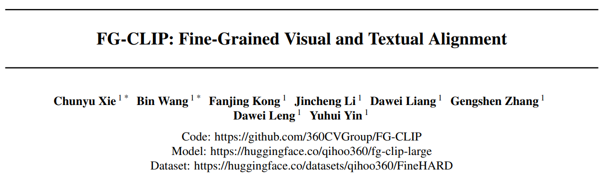
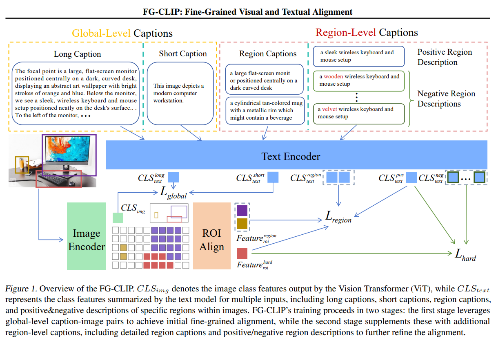
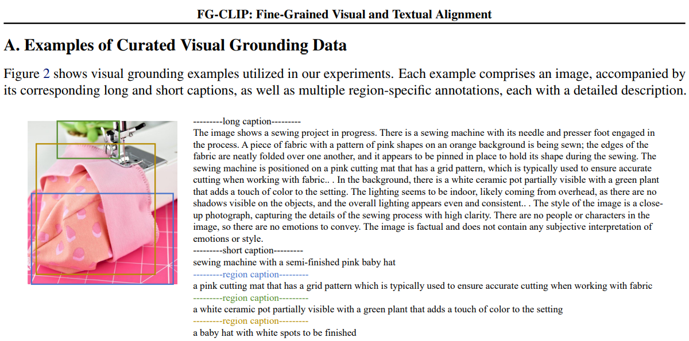
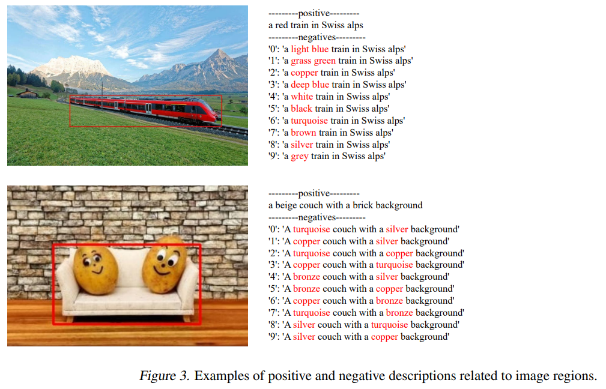
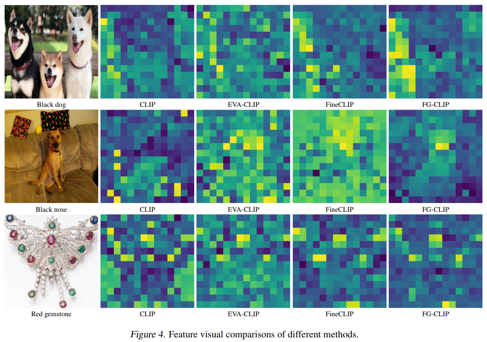

# 基本信息
* 论文标题：FG-CLIP: Fine-Grained Visual and Textual Alignment
* 作者单位：360
* 论文链接：[https://arxiv.org/abs/2505.05071](https://arxiv.org/abs/2505.05071)
* 来源：ICML 2025

# Motivation：论文要解决的问题是什么

基于对比学习的CLIP方法无法感知图片的细粒度特征。本文通过大模型标注了大规模的图片和长文本的细粒度对齐数据集FineHARD，使用FineHARD数据集，通过多阶段预训练CLIP，得到得到FG-CLIP，显著提升了模型对图片的细粒度感知能力。

# 整体流程

整体流程如图Fig1所示，核心思想是借助各种大模型工具对图片进行长文本、细粒度的标注，然后基于标注数据进行细粒度的图文对比学习。主要包括两阶段训练，第一阶段是进行图文整体的对齐，第二阶段是进行图文细粒度的对齐，下面分别介绍。

# 第一阶段：图文整体对齐

## 数据准备

LAION-2B dataset是前人开源的包含20亿图文pair的数据集，本文使用CogVLM2-19B多模态大模型对这个数据集进行重新标注，生成了每张图片的详细的文本描述。作者使用160卡910B集群，标注了30天。下面Fig2是一个标注例子，其中的short caption就是LAION-2B dataset原本的文本描述，其中的long caption就是用多模态大模型重新生成的长文本描述。

## 模型训练
第一阶段只对图片和文本的整体进行对齐，对于第\(i\)个图片\(v_i\)和文本\(t_i\)二元组（可能是长文本或短文本），使用如下对称的InfoNCE loss进行预训练。其中度量函数\(s(\cdot)\)是cos相似度；\(\tau\)是温度系数=0.07；N是batchsize的大小，故第一阶段没有难负例，全部使用in-batch负例，属于常规操作。

$$
\begin{equation}
\begin{aligned}
L_{global} = -\frac{1}{2N} \sum_{i=1}^{N} \Big(&\log \frac{\exp(s(v_i, t_i)/\tau)}{\sum_{j=1}^{N} \exp(s(v_i, t_j)/\tau)} \\
&+ \log \frac{\exp(s(t_i, v_i)/\tau)}{\sum_{j=1}^{N} \exp(s(t_i, v_j)/\tau)}\Big),
\end{aligned}
\end{equation}\tag{2}
$$

# 第二阶段：图文细粒度对齐

## 数据准备

GRIT dataset是前人开源的包含9kw图片及其中1.3亿目标和文本的标注数据，里面的数据是COYO-700M 和 LAION-2B的子集。因此可以推测GRIT的原始文本描述也是短文本，原始bounding boxes也只框选出了主要物体。

基于GRIT数据集，本文首先仍然使用多模态大模型CogVLM2-19B重新生成了长文本描述。然后，使用开源NLP处理工具SpaCy解析长文本描述，并提取出其中的referring expressions，我理解就是其中的名词短语，其实就是具体bounding box的描述短语。最后，把图片和referring expressions短语喂给预训练目标检测模型Yolo-World模型，拿到referring expressions对应的bounding boxes。由此完成了对GRIT数据集的详细的目标检测的标注。

通过上述步骤，对1.2kw图片数据标注了4kw的细粒度的bounding box和对应的region caption。上图Fig2展示了三个bounding box和对应的region caption。

此外，除了上述标注的正样本之外，本文还针对bounding box人工构造了难负例。具体来说，针对每一个bounding box对应的region caption，使用大模型Llama-3.1-70B，在不改变主体的情况下，修改了描述中的属性词，对每个bounding box生成了10个难负例。难负例case如下图Fig3所示。

作者仍然使用160卡910B集群，花费7天完成了上述第二阶段的数据标注工作。

## 模型训练

第二阶段的对齐包括三个对齐任务：图文整体对齐、图文区域对齐、难负例对比学习。其中的图文整体对齐\(L_{global}\)和第一阶段的任务完全一致。

图文区域对齐是根据样本构造中得到的<bounding box, region caption>元组进行对比学习。具体来说，对于第i个bounding box，通过RoIAlign技术，拿到这个bounding box的实体的token，然后对这些token emb进行avg pooling作为这个区域的img emb \(r_i\)。根据上文的样本构造过程，\(r_i\)与区域文本描述\(l_i\)进行对比学习。公式如下，其中K是一个batch内所有的bounding box总数，负例也是in-batch负例，对称InfoNCE loss。

$$
\begin{equation}
\begin{aligned}
L_{regional} = -\frac{1}{2K} \sum_{i=1}^{K} \Big(&\log \frac{\exp(s(r_i, l_i)/\tau)}{\sum_{j=1}^{K} \exp(s(r_i, l_j)/\tau)} \\
&+ \log \frac{\exp(s(l_i, r_i)/\tau)}{\sum_{j=1}^{K} \exp(s(l_i, r_j)/\tau)}\Big).
\end{aligned}
\end{equation}\tag{3}
$$

难负例对比学习。上面的\(L_{regional}\)使用的是in-batch的简单负例，为了进一步增加任务难例，提升模型对细粒度特征的区分能力，对于每个bounding box，使用上面标注的难负例进行进一步的对比学习。如下公式所示，对每个区域图像表征\(r_i\)，其正样本是\(l_{i,1}\)，负样本是\(l_{i,j}\)（j>1）。上面样本构造提到每个bounding box生产了10个难负例文本，因此M应该是11。

$$
\begin{equation}
L_{hard} = -\frac{1}{K} \sum_{i=1}^{K} \log \frac{\exp(s(r_i, l_{i,1})/\tau)}{\sum_{j=1}^{M} \exp(s(r_i, l_{i,j})/\tau)},
\end{equation}\tag{4}
$$

最后，上述3个loss联合训练，第二阶段的整体loss如下，其中\(\alpha=0.1\)，\(\beta=0.5\)。

$$
\begin{equation}
L = L_{global} + \alpha * L_{regional} + \beta * L_{hard}.
\end{equation}\tag{5}
$$

# 结果

核心结论是通过上述细粒度标注数据和多阶段对比学习，FG-CLIP比其他模型能更好地识别图片的细粒度特征。

有一个有意思的结果是，对于同一张图片，不同文本激活的图片子区域不一样。作者展示的结果在Fig4。可视化方法是：使用文本emb与每一个图片token emb算相似度，相似度越高，对应区域的颜色越亮，由此可以得到如下的可视化效果。作者发现经过细粒度的对比学习之后，文本emb确实与最相关的图片区域进行了对齐。（因为第二阶段预训练的时候就是做了这个任务，肯定要在这个任务上效果好才符合预期）

# 评价
* 优点：
    * 整体方法比较简单，工业场景可借鉴、可落地
* 不足：
    * 算法创新性不足，感觉主要是样本标注，以及各种工具的组合使用
    * 无论是全局对齐还是局部对齐，本质上都是对比学习，模型并没有真正理解图片和文本token，总感觉没有触及问题的本质？
