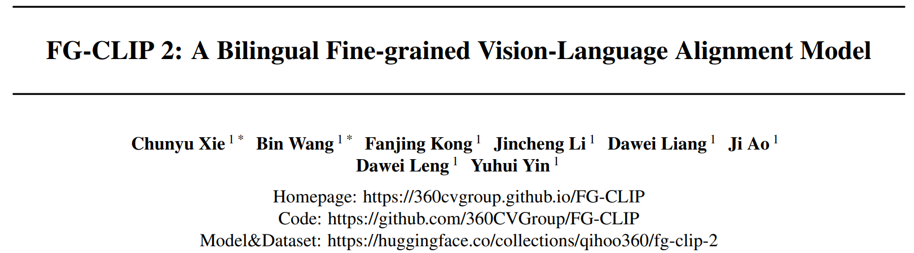
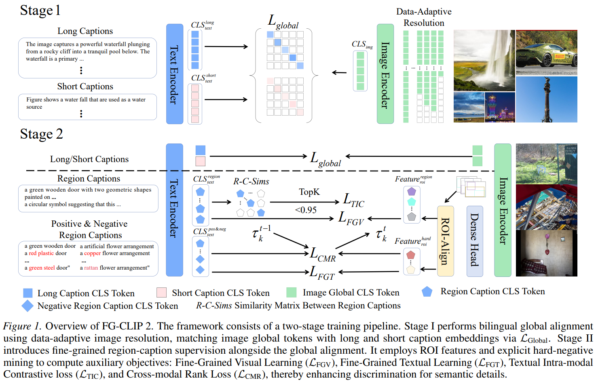
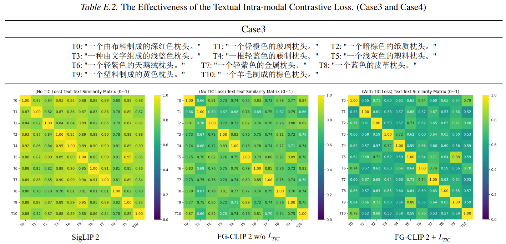

# 基本信息
* 论文标题：FG-CLIP 2: A Bilingual Fine-grained Vision-Language Alignment Model
* 作者单位：360
* 论文链接：[https://arxiv.org/abs/2510.10921](https://arxiv.org/abs/2510.10921)
* 来源：ICML2026

# Motivation：论文要解决的问题是什么

常规CLIP模型能比较好地对齐图片和文本整体语义，但是对图文细粒度语义的理解能力较差，特别是在中文场景。本文在作者已发表的FG-CLIP基础上，做了小幅升级，升级成支持中英双语的模型，同时新增了文本模态内部的对比学习损失（Textual Intra-modal Contrastive, TIC, loss），总体算法创新比较小，阅读本文之前建议先看看FG-CLIP的论文解读：[https://bitjoy.net/posts/2026-10-24-360-fg-clip-paper-reading/](https://bitjoy.net/posts/2026-10-24-360-fg-clip-paper-reading/)。

# 整体流程
FG-CLIP2的整体流程与FG-CLIP类似，也是两阶段。第一阶段对图片和长短文本进行全局整体对齐；第二阶段对图片区域和局部文本描述进行细粒度对齐。新版在旧版基础上，新增了中文语料数据，同时在第二阶段对齐的时候增加了更多的对齐任务和loss。

# 第一阶段：图文整体对齐
## 数据准备
第一阶段主要目标是图片和文本的整体对齐。使用的英文数据集和FG-CLIP一样，基于LAION-2B，然后用MLLM recaption产出长文本描述。中文数据集包括三个：Wukong (100M
pairs) (Gu et al., 2022), Zero (250M pairs) (Xie et al., 2023), and a large-scale in-house dataset (500M pairs)。没有详细介绍中文数据集，需要自己看对应的参考文献。

## 模型训练
第一阶段是图文整体对齐，对齐loss与SigLIP一样，使用的是sigmoid loss，对batch size更不敏感。图片同时对齐长文本和短文本描述。全局对齐loss定义为\(L_{Global}\)。

# 第二阶段：图文细粒度对齐
## 数据准备
第二阶段是图文细粒度对齐，英文数据集与FG-CLIP一样，是FineHARD数据集。中文数据集的生产流程与FineHARD一样，产出了包含1.2kw图片的带bounding box和细粒度中文描述的样本，命名为FineRegion-CN数据集。

## 模型训练
第二阶段的细粒度对齐任务有4个：
* 细粒度的视觉学习任务：局部图片表征与局部文本描述的对齐，文中说是对比学习loss，没给出具体公式，定义为\(L_{FGV}\)
* 细粒度的文本学习任务：对于局部图文pair，把文本描述替换成10个难负例文本，使用二元分类loss进行学习，没给出具体公式，定义为\(L_{FGT}\)
* 文本模态的对比学习任务：为了增强text encoder对语义相似的文本的区分能力，对同batch内文本相似度>0.95的文本，取top-10相似文本作为难负例，进行对比学习训练，loss如下，其中\(\mathcal{T}_i\)是\(T_i\)的top-10相似的难负例，这个公式相当于没有正例的InfoNCE loss。

$$
\mathcal{L}_{\text{TIC}} = -\sum_{i=1}^{N} \log \frac{1}{\sum_{T_m \in \mathcal{T}_i} \exp(S(T_i, T_m))},\tag{1}
$$

作者附录有几个例子，如下Table E.2，T0相当于anchor，T1~T10相当于10个文本难负例，增加TIC训练任务之后，heatmap颜色最深，即难负例之间的相似度最低，相当于难负例区分得更好了。

* 跨模态排序任务：对于正样本二元组（I,T），I的难负例集合是\(T_k\)，设计如下margin loss，本质上就是要求正样本的相似度至少要比难负例的相似度大\(\tau_k\)

$$
\mathcal{L}_{\text{CMR}} = \max (0, S(I, T_k) - S(I, T) + \tau_k),\tag{2}
$$

其中\(\tau_k\)是根据上一步算出来的全局平均值。通过每一步动态更新\(\tau_k\)，使得模型训练更加稳定。

$$
\tau_k^t = \frac{1}{|\mathcal{B}_{\text{global}}|} \sum_{(I,T) \in \mathcal{B}_{\text{global}}} (S^{t-1}(I,T) - S^{t-1}(I,T_k)),\tag{3}
$$

最终，第二阶段的任务就是上述4个细粒度训练任务加第一阶段的全局对齐任务，4个loss权重分别是0.1、0.5、0.1、0.4。

$$
\mathcal{L} = \mathcal{L}_{\text{Global}} + \lambda_1 \mathcal{L}_{\text{FGV}} + \lambda_2 \mathcal{L}_{\text{FGT}} + \lambda_3 \mathcal{L}_{\text{TIC}} + \lambda_4 \mathcal{L}_{\text{CMR}},\tag{4}
$$

FG-CLIP2相比于FG-CLIP，前两个loss是一样的，新增了后两个loss。

# 结果
结果部分有很多实验，通过各种evaluation任务说明FG-CLIP2在图文整体和细粒度任务上都有更好的效果，尤其是在中文数据集上有更好的效果。而且增加中文训练数据之后，对英文任务也有提升作用。

# 评价

* 优点
    * TIC loss有借鉴意义
    * 各种样本构造方法、对比实验设计方法等有一定参考意义
* 不足
    * FG-CLIP连续两篇都发表在ICML，对ICML有点祛魅了。。。
    * 如果说FG-CLIP还有一定新意的话，FG-CLIP2创新性就太弱了，核心是把FG-CLIP扩展到中文语料，然后第二阶段训练加了TIC和CMR两个任务，而且两个任务loss也都是常规操作，感觉不至于发ICML吧，是写作和实验比较充分？
    * 既然是FG-CLIP的升级版，应该重点介绍下FG-CLIP本身有什么缺点和不足，而不是还和FG-CLIP一样泛泛而谈CLIP对细节的捕捉能力不足。对于我刚看完FG-CLIP，再看FG-CLIP2，完全不知道论文的motivation是什么，以及FG-CLIP2要解决FG-CLIP的问题是什么
    * 第一和第二阶段的很多loss都没有细节描述，没有公式，新版应该是采用了SigLIP的sigmoid loss，但也有一些loss说是contrastive loss，没有给出具体公式的话就不知道细节
    * 第二阶段5个loss，真的能学好吗？
