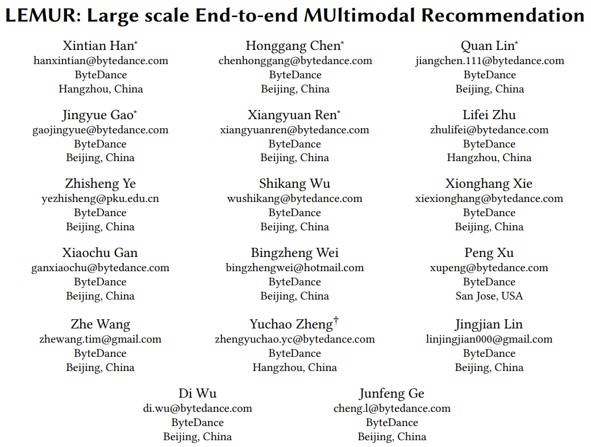
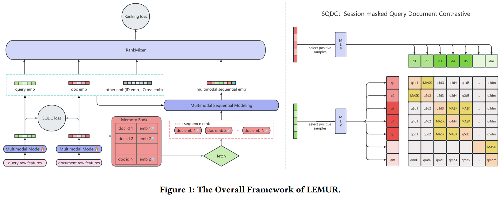

# 基本信息
* 论文标题：LEMUR: Large scale End-to-end MUltimodal Recommendation
* 作者单位：字节
* 论文链接：[https://arxiv.org/abs/2511.10962](https://arxiv.org/abs/2511.10962)
* 来源：Arxiv

# Motivation：论文要解决的问题是什么
多模态信息对搜推系统很重要，目前搜推模型使用多模态特征的主流方法是两阶段式的，即先预训练多模态encoder并产出多模态emb，然后冻结emb加入下游排序模型。两阶段方式虽然实现了上下游解耦，方便各自迭代，但存在以下三个问题：
* 多模态encoder的预训练目标与下游任务的目标不一致，导致预训练对下游的提升帮助不大
* 下游排序任务被ID特征主导训练，加入的冻结的多模态emb无法起到很大的作用
* 多模态encdoer和下游排序模型的更新频率不一致，多模态encoder通常是冻结的，导致无法与下游任务做到实时动态适配，随着下游任务的训练，多模态emb的作用会逐渐衰减
* 多模态emb线上服务压力大

由于上述两阶段方式存在诸多弊端，本文提出直接把原始多模态特征加入排序模型，端到端联合训练排序模型和多模态encoder，期望能最大化利用多模态信息。由于联合训练的成本较高，作者结合了诸多工程优化技术。

# 模型结构
整体模型结构如图Fig1所示。上层特征交叉和scaling模块是字节的RankMixer，本文重点关注下面的emb层。

本文的建模场景是抖音短视频搜索，输入的多模态特征是query和video（文章称为doc），但是作者并没有使用video的视觉特征，而是通过OCR、ASR等方法把视频的封面图片、关键帧、音频等都转换成文本特征了。所以图中的Multimodal Model很可能只是一个文本encoder。

搜索词q和候选视频d通过transformer-based的Multimodal Model编码后分别得到多模态表征\(q_i\)和\(d_i\)。

然后作者设计了一个q/d对齐模块SQDC，认为发生点击的(q,d)二元组是正样本，同batch内的其他d是负样本。但是需要把同一个q对应的其他未点击d进行mask。即担心曝光未点击的可能是假负例。使用对比学习InfoNCE loss，如下。

$$
\ell_{\text{SQDC}} = \sum_{i, \text{label}_i=1} -\log \frac{\exp (\operatorname{sim}(q_i, d_i) * T)}{\sum_{j=0}^{K} A_{ij} * \exp (\operatorname{sim}(q_i, d_j) * T)}\tag{6}
$$

$$
A_{ij} = \begin{cases} 
0 & \text{if } i \neq j \text{ and } \text{QID}_i = \text{QID}_j \\ 
1 & \text{else} 
\end{cases}\tag{7}
$$

图Fig1右边的SQDC展示了mask的过程，比如q1/q2是相同的q，q3/q4/q5也是相同的q，则它们算负例的时候内部要互相mask掉，只和不同q的d算负例。整体是非常常规的操作，不值得论文大书特书啊。

上面的多模态模型实际上只编码了q和商品侧的d，由于用户历史行为流的d非常多，出于性能考虑，作者并没有对历史行为中的d过多模态模型进行实时编码。而是把商品侧的d过了多模态模型的emb存到一个memory bank里面，作为cache。然后用户历史行为中的d通过查询memory bank，拿到cache的多模态emb，然后再进入到多模态的用户序列建模模块，作者使用的是字节的LONGER模型。作者认为，由于它们的训练数据范围是2个月，而用户历史行为是1个月，故memory bank里存的商品侧的多模态emb基本能覆盖用户历史行为流中的商品。

为了进一步提升训练效率，作者还做了如下工程优化：
* Flash attention和混合精度训练
* 只随机采样20%的样本才会激活多模态模型，其他80%的样本都直接从memory bank里取cache的多模态emb
* 对于每个batch，先把batch内的所有候选d进行去重，去重之后再过多模态模型，显著减少重复计算

最后，实验表明多模态模型和排序模型联合训练之后，相比于之前的两阶段预训练方式，显著提升了排序模型的AUC指标。

# 评价
* 优点
    * 至少说明多模态模型与排序模型联合训练的收益上限更高
* 不足
    * 论文太简单了，创新性不足
    * 为什么要加q和d的对比学习，没讲清楚，除非需要有显式的相似度关系才这么做
    * SQDC的对比学习，就是常规的q和d的对比学习，加了个同query的mask，这个太常规操作了，不值一提
    * 也没提SQDC loss和排序loss怎么加权融合的
    * 为了实现端到端联合训练，多模态模块的训练样本做了大幅采样，而且只对target item生效，用户历史行为流取的cache，可以说做了很多妥协
    * 方法中的多模态模型本质上可能只是个文本模型，也没提模型大小
