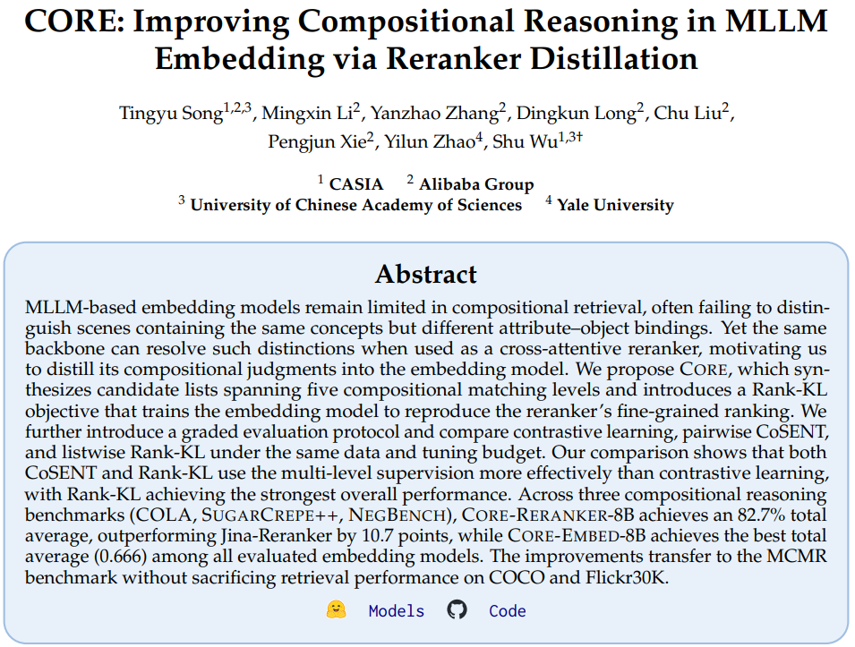
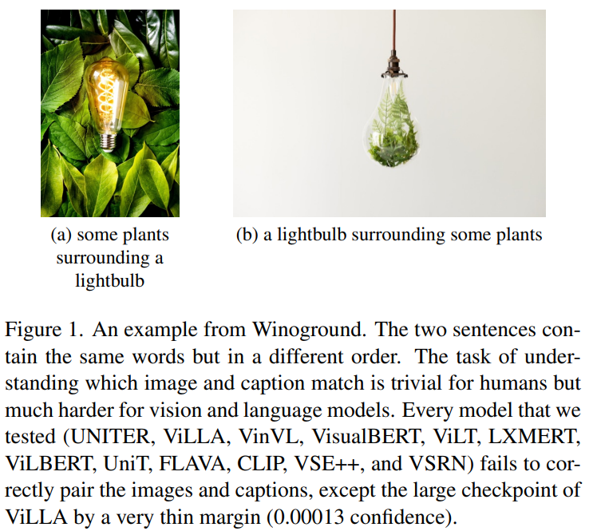
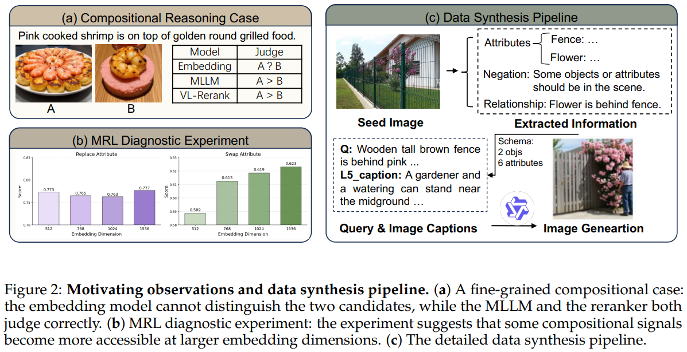
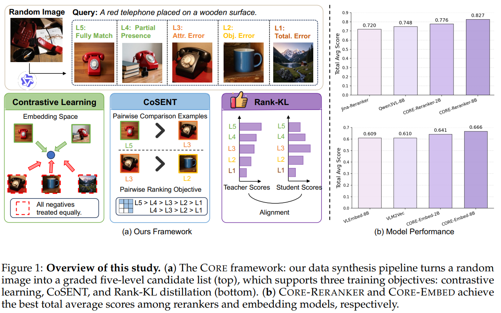
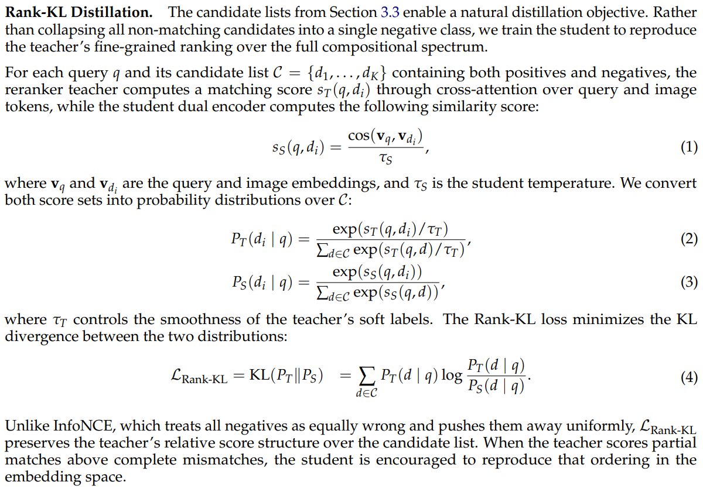

# 基本信息
* 论文标题：CORE: Improving Compositional Reasoning in MLLM Embedding via Reranker Distillation
* 作者单位：阿里
* 论文链接：[https://arxiv.org/abs/2609.04083](https://arxiv.org/abs/2609.04083)
* 来源：Arxiv

# Motivation：论文要解决的问题是什么

现有的MLLM多模态emb在组合推理任务上表现比较差。组合推理任务按照原文的定义是指要理解图片中不同实体的属性、相对关系等各种信息的组合关系：

> Compositional reasoning, the ability to understand novel combinations of objects, attributes, and relations, remains a fundamental challenge in vision-language understanding

本文引用这篇文章：[Winoground: Probing Vision and Language Models for Visio-Linguistic Compositionality](https://arxiv.org/abs/2204.03162)，里面有个很有意思的例子，如下图所示：两句话单词完全一样，但是单词的顺序不同，表达的意思完全不同，匹配的图片也完全不同，但是现有的多模态emb模型完全无法区分这两句话。这就是多模态emb的组合推理能力表现不佳的问题。

本文Fig2a也举了一个例子，query是：Pink cooked shrimp is on top of golden round grilled food（粉红烤虾放在金黄圆润的烤制食物上），问query和图片A/B哪个更像。作者发现多模态emb无法区分query emb和A/B图片emb的相似度。但是同样基座的MLLM和VL-Reranker模型却可以回答出来A与query更像。所以引出本文要解决的核心问题是，如何增强emb的组合推理能力。本文进一步发现reranker模型有这个能力，所以进一步聚焦如何把reranker的这种能力蒸馏到emb模型上。

其实emb的组合推理能力听起来很玄乎，但是本文要解决的问题本质上是emb对不同相似图片的分层区分能力。如下Fig1(a)图所示，给定一个query和5张图片，5张图片和query的相似度不是非黑即白的关系，而是有不同相似程度的区别。因为5张图片的区别就是图片中实体的属性、关系的组合区别，如果emb能区分出来query和5张图片的相似度依次是L5>L4>L3>L2>L1，则认为emb具备了组合推理能力。

传统的多模态emb大多数是通过对比学习训练得到的，如Fig1(a)左下角的图，因为对比学习训练的时候对所有负例一视同仁，相当于只训练了二元的像与不像的能力，故对比学习对所有不像的都认为不像，但其实不像的图片里面也能进一步区分出三六九等。类似的，对像的图片也是同样的道理。这就需要依赖更细粒度的图片表征能力了，也就是文中说的组合推理能力。

# 核心思想

搞清楚问题之后，解法相对来说比较简单。既然现有emb缺乏分层区分能力是因为对比学习预训练只有二元区分能力，那直接的想法就是标注多层次的相似度样本，然后使用listwise的方法预训练emb模型就可以了。由此引出来两个问题，一是如何批量标注多层次的listwise相似度样本，二是如何利用listwise样本训练emb模型。

# Listwise样本构造流程

最终训练的listwise样本形如Fig1(a)所示，包含一个query，以及5张不同相似度等级的图片。本文把图文相似度分为5个等级：L5完全匹配（包括主体、属性、关系等）；L4完全匹配，但是主体只是整张图片的一部分；L3属性不匹配；L2主体不匹配；L1完全不匹配。

样本构造过程如图Fig2(c)，具体如下：

1.	从LAION-400M数据集采样种子图片
2.	使用Qwen3-VL-32B理解图片，输出图片中的实体、属性、实体关系等信息
3.	随机采样一个schema，其实就是确定两个参数：(\(n_{obj}\), \(n_{attr}\))，分别表示从上一步抽取的全集信息中采样的实体数量和属性数量
4.	将种子图片，上一步采样的实体和属性，喂给MLLM模型，让MLLM生成描述种子图片的query，以及符合5档相似度的5个图片描述caption文本
5.	利用种子图片+上一步的5个图片描述caption文本，调用Z-Image-Turbo，生成符合描述的图片
6.	由此得到<query, L5图片, L4图片, L3图片, L2图片, L1图片> listwise样本

可以看到上述过程不论是query还是图片，都是通过模型生成的，数据质量完全取决于模型效果。故本文还增加了两个数据质量筛选的后处理步骤，都是通过MLLM来完成的，一是确保第5步生成的图片符合caption语义；二是确保第5步生成的图片和query满足相似度分档。通过上述两步筛选，保留了78%的样本。对保留的样本，通过人工check的方式评估了与人工的一致率是94%。

附录中包含样本生产的prompt。

# Emb训练方法

有了listwise样本之后，比较简单的方法就是套一个pairwise或者listwise loss就可以训练了。比如最简单的文中提到的CoSENT loss就行，如图Fig1中间所示。

本文提出了另外一种思路，因为在Fig2(a)的预实验中，作者发现，虽然emb模型的分层区分能力比较差，但是相同基模的MLLM或者Reranker模型是有这个区分能力的。所以，作者直接对listwise样本，用Reranker模型再次打分，得到5个具体的相似度分，作为soft label，然后通过KL loss的方式，拉进emb模型的emb相似度分布与Reranker模型打的分数。相当于emb模型蒸馏Reranker模型。

因为直接用5档相似度作为listwise的label的话，相当于hard label，而使用reranker的打分的话相当于soft label。Soft label蕴含的信息更加丰富，故soft label理论上会比hard label的listwise loss方法效果更好。

具体公式如下：query和5张图片的emb相似度打分作为学生分数；query和5张图片的reranker单塔打分作为教师分数，然后通过KL loss拉进两个分数分布的距离。

# 实验结果

主要结论如下：
* 本文的方法在组合推理任务（即类似本文构造的listwise分层排序任务）上的效果最佳
* 本文是基于开源emb模型微调的，即使经过了微调，其emb的检索能力（可以理解为针对微调前的对比学习预训练的任务）也没有降，甚至还有所提升
* 本文的Rank-KL loss方法与CoSENT这种pairwise loss方法效果相当，会更好一些

# 评价

* 优点
    * 针对emb在组合推理任务上表现不佳的问题，发现可以通过蒸馏reranker的能力来提升emb的能力，并由此提出了一套样本生产和模型训练的流程，显著提升了emb的分层排序能力
* 不足
    * Emb的组合推理能力是一个很大的话题，但是本文的具体解法是让emb具备分层排序能力，这两者感觉不完全是一回事，emb具备分层排序能力与emb有组合推理能力并不等价吧？感觉把概念搞复杂了，直接针对emb分层排序问题进行写作是不是会更直接一些。
    * 本文的样本构造无论是query还是图片，都是大模型生成的，有可能与真实分布不一致。特别是在生成图片caption时，只是把相应的主体或者属性换一换，只能得到比较简单的、直接的相似关系样本，无法生成隐式相似样本。比如座机和手机的相似、牙刷和牙膏的相似等间接相似关系。
    * 5档相似度的划分有可能并不合理，特别是L2和L1之间应该还能细分
    * Rank-KL loss效果虽然比CoSENT好一点，但是需要的额外成本要高很多，因为需要额外的Reranker模型打分。CoSENT可以只用5档相似度的档位就行，有可能性价比更高。
    * Table 5评测发现本文的CORE方法比微调前的VL-EMB模型，在召回任务上的效果也没有降，甚至有所提升，这个感觉不太合理。因为召回emb是通过二元对比学习训练得到的，只区分特别像和所有不像的，理论上对特别像那部分候选的区分能力是比本文CORE更好的。举个简单的例子，比如Fig1(a)中，有可能L5里面还能再细分，比如同款式的，无绳的等等。对比学习有可能学习了L5更细分的像与所有的不像，而本文CORE对L5内部其实是没有区分能力的。
