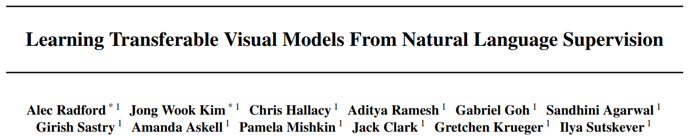
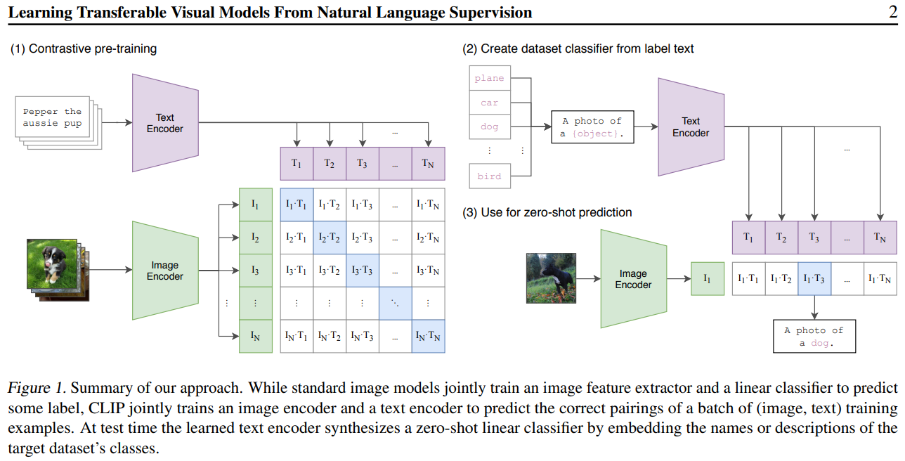
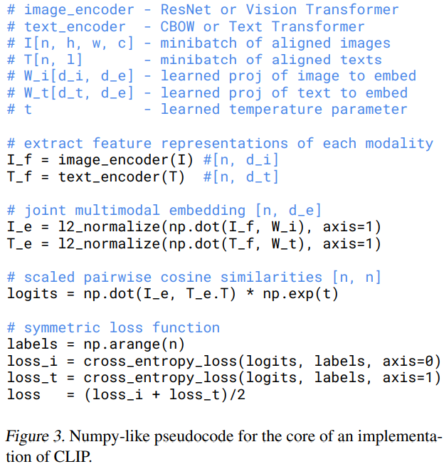

# 基本信息
* 论文标题：Learning Transferable Visual Models From Natural Language Supervision
* 作者单位：OpenAI
* 论文链接：[https://arxiv.org/abs/2103.00020](https://arxiv.org/abs/2103.00020) 这个版本太长了，建议看ICML精简版：[https://proceedings.mlr.press/v139/radford21a.html](https://proceedings.mlr.press/v139/radford21a.html)
* 来源：ICML2021

# Motivation：论文要解决的问题是什么
传统的CV模型都是在某个特定数据集上的特定任务上训练出来的模型，导致这些视觉模型无法迁移到新的任务上。核心原因是这些特定任务的label是人工定义的{0,1,2…N}这种label，不同任务的这些label的含义各不相同，导致无法迁移。

本文的核心思想很简单，既然人工定义的{0,1,2…N}这种label不具有迁移性，那我把label换成自然语言描述的label，是不是就有迁移性了。核心就是文中这句话：

>Learning from natural language also has an important advantage over most unsupervised or self-supervised learning approaches in that it doesn’t “just” learn a representation but also connects that representation to language which enables flexible zero-shot transfer.

对应论文标题就是用Natural Language作为Supervision，以达到Transferable的效果。

核心思想比较简单，文中也说类似的思想借鉴了GPT的工作，GPT的预训练就是把所有NLP任务都统一成NTP生成任务了。所以本质上世界上所有任务都可以用文本来统一描述。

# CLIP模型结构
站在2026年回看2021年的CLIP工作还是比较简单的。如下图Fig1(1)所示，首先通过互联网收集了约4亿的图片和文本二元组；然后图片和文本分别过各自的encoder拿到embedding表征；最后通过InfoNCE对比学习训练。

假设对比学习的时候batchsize是N，则能拿到N个图片embedding与N个文本embedding，构成如图Fig1(1)的N*N的矩阵。因为只有第i张图片与第i个文本是配对的正样本，故矩阵中只有对角线的位置label才是1，其他非对角位置的label都是0。

现在看CLIP就是最简单最标准的对比学习，负例只有in-batch负例。模型训练的时候，作者通过混合精度、梯度检查点等策略，将batchsize开到了32768，当然这也可能和CLIP的图文encoder参数量不是很大有关。文中作者提到CLIP的效果与文本encoder的参数量关系不是很大。图像encoder作者尝试了ResNet类型的和ViT类型的，发现ViT-L/14搭配336分辨率，效果最好。

训练细节方面，InfoNCE loss的温度系数是0.07，使用592卡V100，训练了18天，共计32个epoch。

文中还非常贴心地给出了训练伪代码，如下图Fig3所示，作者发现CLIP只需要对图文embedding做线性变换就行，不需要像SimCLR一样做非线性变换，另外对比学习loss使用的是对称的InfoNCE loss。

使用方面，如何做到zero-shot的迁移效果呢？如图Fig1(2,3)所示，假设CLIP预训练好之后，我们需要在一个新的图像数据上做图像分类问题，这个分类任务共有10个类别，比如plane、car、dog等，则我们通过构造10条文本：A photo of a {object}，这个{object}分别换成plane、car、dog等。得到10条文本之后，分别送到文本encoder中得到10个文本的embedding，相当于10个label的embedding。

然后，把待分类的图片，送到图像encdoer中拿到图片embedding。将图片embedding与10个文本embedding算相似度，取相似度最大的作为这个图片的分类结果。通过这种方法，CLIP实现了跨数据跨任务的zero-shot迁移。

本质上就是CLIP在预训练的时候把图像表征对齐到文本空间了，由于所有任务都可以用文本描述，所以实现了图像表征的zero-shot迁移。

# 结果
结果非常丰富，在几十个任务上做了详细的评测，甚至还做了风险测试，发现训练样本中男性图片更容易和罪犯、吸烟等文本构成正样本，导致模型存在bias等。

总之结论就是CLIP的zero-shot迁移效果非常好，在ImageNet上的zero-shot效果甚至可以媲美在该数据集上有监督训练的ResNet-50模型。

# 评价
* 优点
    * 多模态领域的代表性工作，方法简单、高效、有效，应用非常广泛，是个很强的base
* 不足
    * 只能学习图文全局对齐效果，无法理解图文细粒度特征
    * 受样本构造方法影响很大，如果正负样本在构造的时候引入了bias，产出的embedding也有很大的bias
    * 与anchor的相似度只有像（正样本）和不像（负样本）的区别，缺乏中间地带的相似度分层效果
